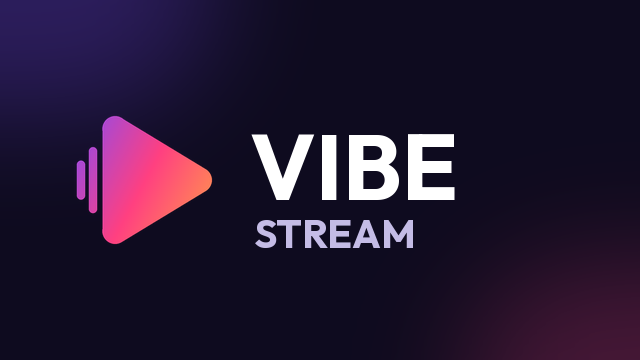

# vibecoded

<p align="center"></p>

## Vibe Stream

**Android TV, Google TV, Fire TV, Android telefon ve iPhone/iPad için ücretsiz, açık kaynak IPTV oynatıcı.**
*Free, open-source IPTV player for Android TV, Fire TV, Android phones and iPhone/iPad.*

[IPVIO Stream](https://github.com/Emrodev/IPVIO-Stream) (Emrodev, GPL-3.0) projesinin bir çatalıdır (fork): güvenlik
düzeltmeleri, kendi uygulama kimliği ve yeni bir iOS uygulaması içerir.

> **Uygulama içerik sağlamaz.** Kanal, film, dizi veya playlist içermez; yalnızca senin eklediğin playlistleri
> (Xtream Codes, M3U, Stalker) oynatır. Sadece kullanma hakkın olan kaynakları kullan.

### İndir / Download

| Cihaz | Dosya | Kurulum |
|---|---|---|
| Android TV, Fire TV, Android telefon | `Vibe-Stream.apk` – [Releases](https://github.com/Bluetwinklez/vibecoded/releases/latest) | "Bilinmeyen uygulamaları yükle" iznini ver, APK'yı aç |
| Fire TV + Downloader | `https://github.com/Bluetwinklez/vibecoded/releases/latest/download/Vibe-Stream.apk` | Adresi Downloader'a yaz |
| iPhone / iPad | `VibeStream-unsigned.ipa` – [Releases](https://github.com/Bluetwinklez/vibecoded/releases/latest) | Apple ID ile imzalanmalı (Sideloadly / AltStore, 7 günde bir yenilenir) – [ayrıntı](vibe-stream/ios/README.md) |

### Özellikler

| | Android | iOS |
|---|:---:|:---:|
| Xtream Codes, M3U | ✓ | ✓ |
| Stalker portal (MAC) | ✓ | – |
| Canlı TV, film, dizi, arama | ✓ | ✓ |
| Favoriler, kaldığın yerden devam | ✓ | ✓ |
| Yayın akışı (EPG) | tam rehber, catch-up, hatırlatıcı | şimdi / sonra |
| Canlı TV geri sarma, kayıt | ✓ | – |
| Spor bölümü, profiller, ebeveyn kilidi | ✓ | – |
| Resim içinde resim, AirPlay | – | ✓ |
| MKV / AVI / TS | ✓ (Media3 + FFmpeg ses) | VLC'ye aktarır |
| Dil | 10 dil (TR dahil) | Türkçe, İngilizce, Almanca |

### IPVIO Stream 1.4.1'e göre farklar

- **Güvenlik:** sertifikası uymayan sağlayıcıya sessizce şifresiz (http) bağlanma kaldırıldı, artık ayardan açılır
  (varsayılan kapalı); telefon sayfaları 6 haneli kod, doğru çalışan deneme kilidi ve sadece yerel ağ erişimi;
  yedek geri yükleme ve ZIP içe aktarmada boyut sınırı; giriş bilgileri Android bulut yedeğine girmez.
- **Hatalar:** Android Lint'in 9 hatası düzeltildi (tarih/saat uygulama dilinde, Compose durum hataları).
- **Kimlik:** ad *Vibe Stream*, paket `com.vibecoded.stream` (orijinalin yanına kurulur), yeni logo,
  güncellemeler bu repodan.
- **Yeni:** iPhone/iPad uygulaması.

Ayrıntılar: [CHANGELOG](vibe-stream/CHANGELOG.md) · [Güvenlik durumu](vibe-stream/docs/SECURITY.md) ·
[Uygulama README'si (EN)](vibe-stream/README.md)

### Durum

- Android: 342 unit test, lint 0 hata. **Cihazda henüz test edilmedi.**
- iOS: çekirdek mantık 14 testle doğrulandı; uygulama CI'da derleniyor. **Cihazda henüz test edilmedi.**

### Geliştirme

```
cd vibe-stream && ./gradlew assembleDebug testDebugUnitTest   # Android
cd vibe-stream/ios && xcodegen generate                         # iOS (macOS)
swift test --package-path vibe-stream/ios/VibeCore             # iOS çekirdek testleri (macOS/Linux)
```

Yeni sürüm yayınlamak: [vibe-stream/docs/RELEASE.md](vibe-stream/docs/RELEASE.md#vibe-stream-fork-releasing-from-github).

### Lisans

GPL-3.0 – [LICENSE](vibe-stream/LICENSE). Orijinal proje: IPVIO Stream © IPVIO Stream contributors.
