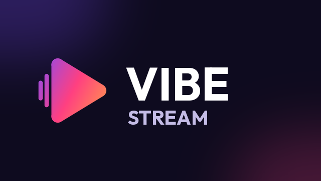
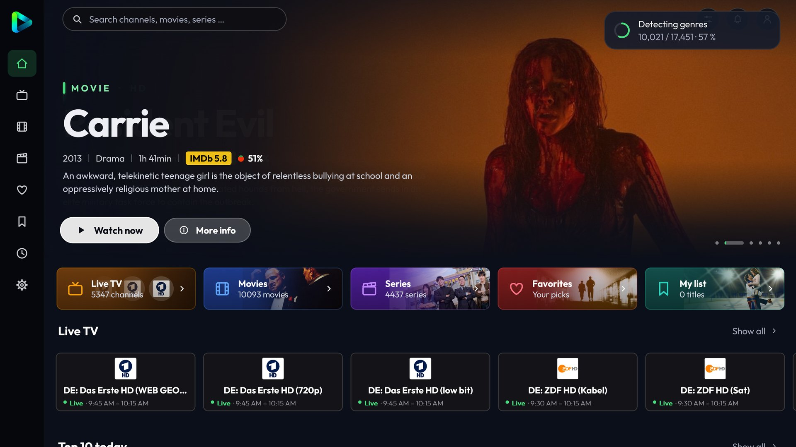
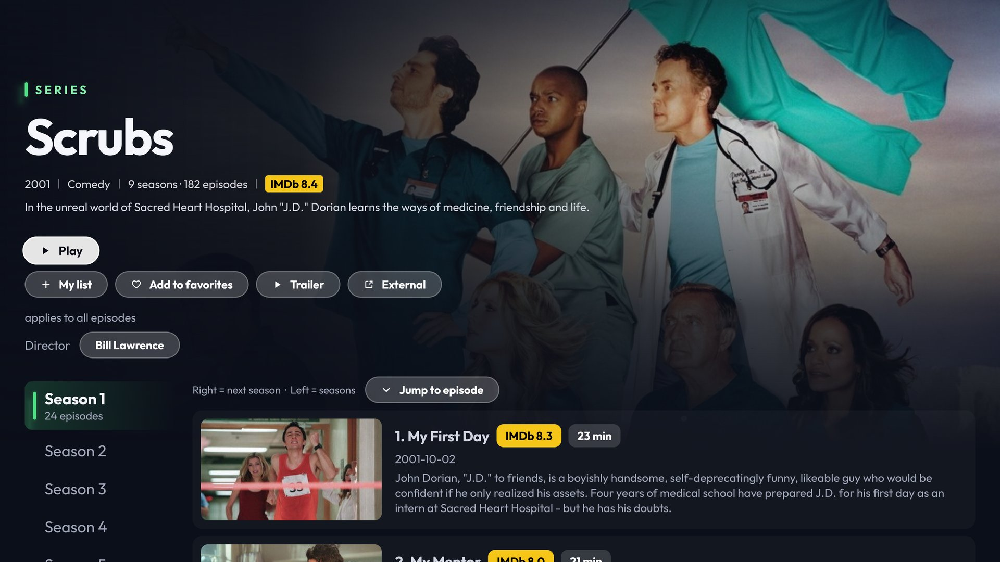
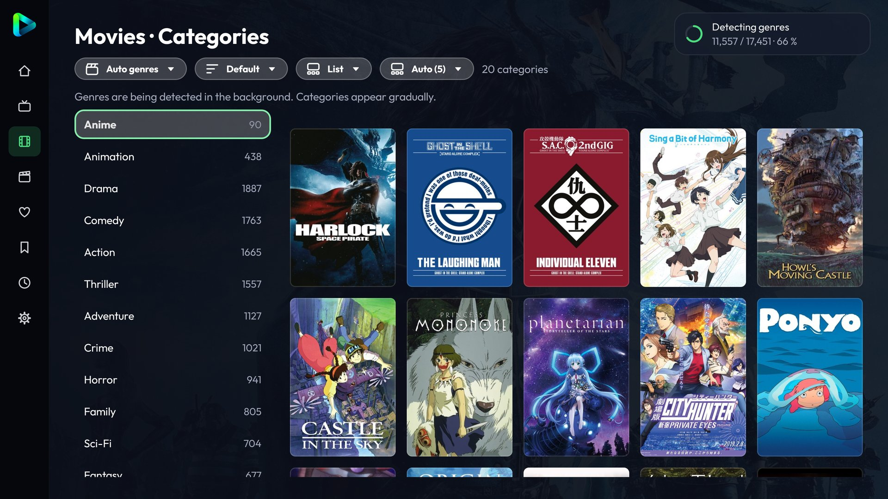
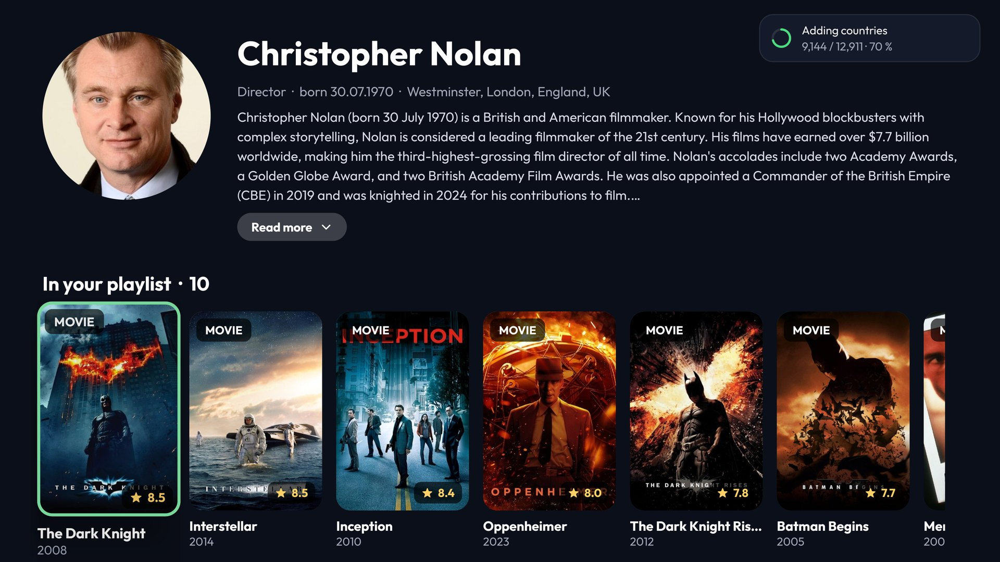
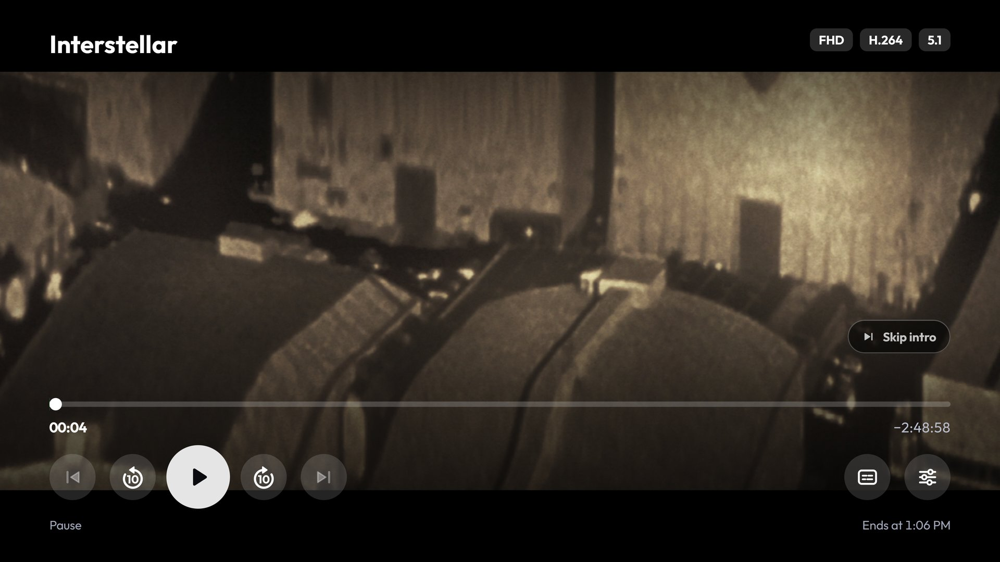
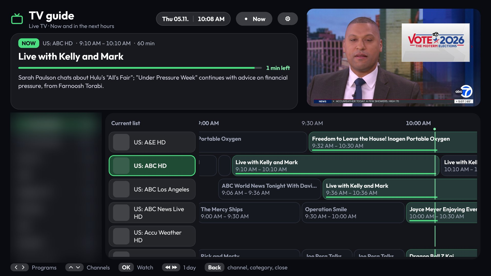
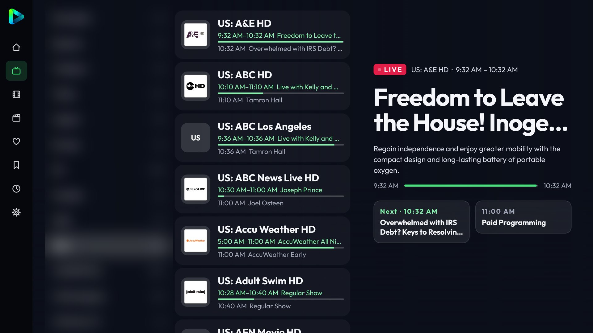
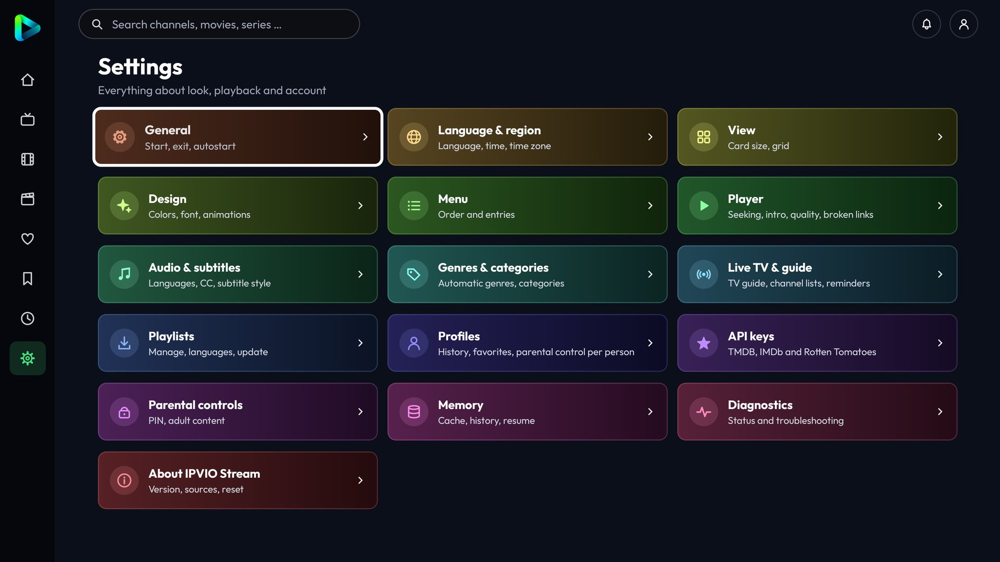

# Vibe Stream

A free, open-source IPTV player for **Android TV, Google TV, Fire TV and Android phones**, plus a native **iPhone / iPad** app.
Vibe Stream is a fork of [IPVIO Stream](https://github.com/Emrodev/IPVIO-Stream) by Emrodev (GPL-3.0) with security fixes,
its own app ID (installs next to the original) and an iOS version.



> **Vibe Stream does not provide any content.** It contains no channels, playlists, films or series. It is only a player for playlists that **you** add yourself (Xtream Codes login, M3U address or Stalker portal). Only use sources that you are legally allowed to use.

## Install

**Android / Fire TV:** download `Vibe-Stream.apk` from the [releases](https://github.com/Bluetwinklez/vibecoded/releases) of this repository
(or the `vibe-stream-release-apk` artifact of the latest CI run), allow "Install unknown apps" for your browser or Downloader, install.

**iPhone / iPad:** see [ios/README.md](ios/README.md). Short version: the app has to be signed with your Apple ID
(free with Sideloadly or AltStore, renewed every 7 days) because Apple does not allow installing unsigned apps.

## Differences from Vibe Stream 1.4.1

- **Security:** no silent switch from HTTPS to unencrypted HTTP when a provider's certificate does not match
  (now an opt-in setting, default off); phone pages use a 6-digit code, answer only devices in the local network and
  lock correctly under parallel guessing; ZIP imports and restores have size limits; no Android cloud backup of
  playlists and logins.
- **Fixes:** all Android Lint errors (dates in the app language, Compose state issues, stray byte-order marks).
- **Identity:** app name Vibe Stream, app ID `com.vibecoded.stream`, own icon, updates from this repository.
- **iOS app** (new): Xtream and M3U, live/movies/series, favorites, resume, TV guide, picture-in-picture.

## Features

**Playlists**
- Xtream Codes login (server, user name, password), an M3U address or file, or a Stalker portal (MAC address); input from your phone over Wi-Fi
- Several playlists at the same time ("Also show"), with a source filter in Movies/Series and a source switch in Live TV
- Xtream accounts load through `player_api.php` automatically when `get.php` is blocked
- Handles very large playlists: language filter while loading, resumable downloads, compact storage
- Automatic background refresh (interval or fixed time, waits during playback)

**Home screen**
- Home, Movies and Series with a large rotating header image
- The background follows the selected title and shows its title, ratings and description
- Rows: Continue watching, Live now, Top 10 today, Because you watched …, My list, New, Top rated, genres

**Browse and details**
- Grid or cinema view, filters by sort order, rating, year, genre and country
- "Top rated" and sorting by rating use IMDb first, then Rotten Tomatoes, TMDB and finally the provider's rating
- Provider categories or automatic genres, search with typo tolerance
- Detail page with resume, trailer, my list, favourites, choice of source/quality
- Series: seasons on the left, episodes on the right with picture, rating and description; sections and "go to episode" for very long series

**Live TV**
- Categories, favourites and your own channel lists
- TV guide, catch-up/archive ("from the beginning"), reminders with notification
- Rewind live TV with an on-device buffer, record the current show (internal storage or USB)
- Sports section: sports on now and coming up, all sports channels

**Player** (Media3 / ExoPlayer)
- Audio and subtitle selection (remembered per title), preferred languages, subtitle style
- FFmpeg audio decoder for AC3/E-AC3/DTS (also over Bluetooth headphones)
- Skip intro and credits (TheIntroDB), next episode automatically
- Quality selection with 4K check, fallback to another source on errors or stuttering
- Buffer levels, connection watchdog, endless reconnect for live TV, reconnect after network change and standby
- HLS, MPEG-DASH and MPEG-TS
- Aspect ratio/zoom, frame-rate matching, technical info, clock overlay, sleep timer

**Personal**
- Profiles ("Who's watching?"), parental controls with PIN
- History, my list, favourites, backup and restore of settings
- Transfer to another device over Wi-Fi, optional Google Drive backup
- In-app updates from GitHub Releases

**Look and feel**
- green on navy plus 12 colour themes, 5 backgrounds, custom colours
- Fonts Outfit, Inter or system; adjustable text and display size; animations off/subtle/normal
- Sidebar left, right or top, icons only or with text; phones: landscape, tap and double-tap controls
- 10 languages: German, English, Turkish, Bosnian, Croatian, Serbian, Spanish, French, Italian, Dutch

## Screenshots

| | |
|---|---|
| <br>**Home** – rotating header, quick tiles, live TV now | <br>**Series details** – seasons, episodes with ratings, director |
| <br>**Automatic genres** – detected in the background | <br>**Cast and crew pages** – with the titles from your playlist |
| <br>**Player** – skip intro, audio/subtitles, quality | <br>**TV guide** – timeline with preview |
| <br>**Live TV** – now and next at a glance | <br>**Settings** – grouped, remote-friendly |

<sub>Screenshots taken on a TV. Film artwork, channel logos and programme data belong to their respective owners; provider categories are blurred.</sub>

## Your own API keys (optional)

The app ships **without any API keys**. You can enter your own free keys in the app under **Settings > API keys**:

| Service | Used for | Key |
|---|---|---|
| TMDB | posters, descriptions in your language, cast, trailers, automatic genres, episode info, similar titles | free, see below |
| OMDb | IMDb and Rotten Tomatoes ratings | free, see below |
| TheIntroDB | intro/recap/credits times | no key needed |

**Without keys** the app still works. With an Xtream Codes playlist it takes description, cover, rating, genres, running time and trailer **directly from your provider** (`player_api.php`). With a TMDB key it uses TMDB first and falls back to the provider when a title is not found. Keys are stored only on the device.

### Get a free TMDB key
1. Create an account at https://www.themoviedb.org/signup and confirm the e-mail address.
2. **Log in.** The API page shows "restricted" as long as you are not logged in.
3. Open https://www.themoviedb.org/settings/api (or: profile picture > Settings > API) and click **Request an API key**.
4. Choose **Developer**, accept the terms and fill in the form (application name e.g. "Vibe Stream", type "Personal use", a short description; the URL can be your GitHub page).
5. Copy the **API Key** (the 32-character one, not the "API Read Access Token").

### Get a free OMDb key
1. Open https://www.omdbapi.com/apikey.aspx, choose **FREE** (1,000 requests per day), enter your e-mail address and a short reason (e.g. "personal media player").
2. You receive an e-mail with an 8-character key and an **activation link**. Click the link, otherwise the key does not work.

### Enter the keys in the app
Settings > **API keys**: paste the key into the field, press **Save and check** (a green "Key valid" confirms it) and restart the app once. Tip: type long keys with the phone import or an USB keyboard instead of the remote.

*This product uses the TMDB API but is not endorsed or certified by TMDB.*

## Building

Requirements: Android Studio (current version) with the Android SDK; the Gradle wrapper downloads everything else.

```
git clone <this repository>
cd vibecoded/vibe-stream
./gradlew assembleDebug        # Windows: gradlew.bat assembleDebug
```

The APK is then in `app/build/outputs/apk/debug/`. For releases and in-app updates see [docs/RELEASE.md](docs/RELEASE.md): every release must be signed with the same key (`keystore.properties`), otherwise users lose their data when updating.

Optional Google Drive backup: [docs/GOOGLE_DRIVE.md](docs/GOOGLE_DRIVE.md).

Developers can optionally copy `secrets.properties.example` to `secrets.properties` (ignored by Git) and put their keys there; they are only used when no key was entered in the app.

Unit tests for the pure logic: `./gradlew test`

## Project layout

```
app/src/main/java/com/ipvio/stream/   all Kotlin sources (one package)
  *Logic.kt                           pure, Android-free logic (covered by unit tests)
  Dict*.kt                            translations (one row per text: de¦en¦tr¦bs¦hr¦sr¦es¦fr¦it)
app/src/test/java/com/ipvio/stream/   JUnit tests
app/src/main/res/font/                Outfit and Inter (SIL Open Font License)
licenses/                             font licences
```

## Credits

Original project: IPVIO Stream by Emrodev – https://github.com/Emrodev/IPVIO-Stream. If you want to support the
original author: https://ko-fi.com/ipviodude

## License

Copyright (C) 2026 IPVIO Stream contributors and Vibe Stream contributors

Vibe Stream is free software: you can redistribute it and/or modify it under the terms of the **GNU General Public License version 3** (see [LICENSE](LICENSE)). The GPL is required because the app includes the GPL-3.0 licensed FFmpeg audio decoder. See [THIRD_PARTY_NOTICES.md](THIRD_PARTY_NOTICES.md) for the libraries, fonts and services used.

The name "IPVIO" and the IPVIO logo identify the original project; this fork uses its own name and logo as the original author asked.

## Disclaimer

This software is provided "as is", without warranty of any kind. The authors do not provide, host, sell or link to any streams or playlists and are not responsible for how the app is used. Using playlists without the rights holders' permission may be illegal in your country.
